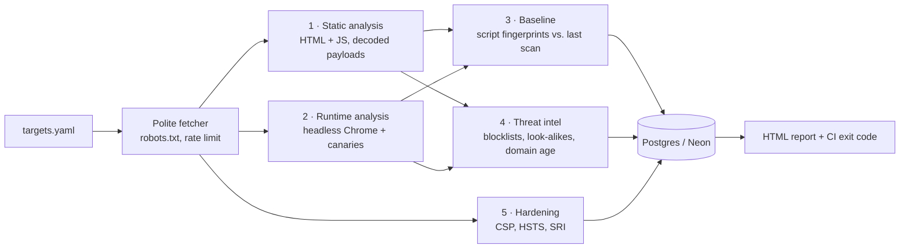

# skimwatch

**skimwatch watches online stores for client-side attacks**: card skimmers, malicious redirects,
cryptominers and compromised third-party scripts. It runs every night, compares each store with
the previous night, and fails loudly when something new and dangerous shows up.

It started from a real finding. While building [SmartCart](https://github.com/aviollaz/SmartCart),
a supermarket price scraper, I found a payment-card skimmer hidden in the product descriptions
of Jumbo, Disco and Vea (Cencosud Argentina, October 2026): an ``
that hooked the checkout and sent card data to an outside server. I reported it and it was taken
down. skimwatch is the tool I wish had been watching those stores.

## How it works

Every page goes through five independent layers. An attacker who evades one still has to get
past the others.



| Layer | What it catches | How |
|---|---|---|
| **Static** | Injected skimmers, obfuscated payloads, miners, cloaked redirects, hidden iframes, card forms posting elsewhere | Parses the HTML, extracts every script, event handler and `javascript:` URL, recursively decodes base64, `fromCharCode` and escape sequences, then correlates behaviors: *reads card fields or hooks fetch/XHR* **and** *sends data to a host the store doesn't control* = probable skimmer |
| **Runtime** | Skimmers that only appear after the page loads, data actually leaving the browser | Loads each page in headless Chrome with an instrumentation script that records every `eval`, every listener on inputs and every request. Then it **types canary values** (a test card number, a fake email) into the page's forms and checks whether they show up in any request to another host, raw, URL-encoded or base64-encoded. That is evidence, not a heuristic |
| **Baseline** | Supply-chain attacks (a trusted script replaced with a malicious version), new third-party code | Fingerprints every script with SHA-256 and compares it with the previous scan. Also flags scripts that a server sends differently to a browser than to a plain HTTP client, a trick skimmers use to hide from scanners |
| **Intel** | Known-malicious infrastructure, look-alike domains, throwaway domains | Blocklists (a seed list plus abuse.ch URLhaus nightly), look-alike detection against about 80 trusted providers (`google-analytlcs.com`, `googletagmanager-cdn.com`, homoglyphs like `rn` → `m`), and RDAP registration dates: skimmer domains are usually days old |
| **Hardening** | Missing defenses | CSP that would or wouldn't stop exfiltration, HSTS, frame protection, third-party scripts without Subresource Integrity |

Every finding has a severity, a plain-language explanation, where it was found and a truncated
evidence snippet. Findings are fingerprinted across scans, so the report separates **new** problems
from known ones, and CI only fails on new ones.

## Quick start

Requires Go 1.24+ and Chrome or Chromium.

```bash
go run ./cmd/skimwatch scan -config targets.yaml -report out/report.html
```

Without a database it keeps history in `.skimwatch/`. With `DATABASE_URL` set (any Postgres; Neon's
free tier works) it stores every scan and finding, keeping the date each finding was first seen.

To check a single suspicious file without touching the network:

```bash
go run ./cmd/skimwatch analyze -url https://www.store.com.ar/ suspicious.js saved-page.html
```

### Flags

| Flag | Default | |
|---|---|---|
| `-config` | `targets.yaml` | Stores to scan |
| `-db` | `$DATABASE_URL` | Postgres for history; empty uses `-state` |
| `-report` / `-json` | `report.html` / none | Outputs |
| `-blocklist` | `data/blocklist.txt` | Repeatable |
| `-no-browser` | false | Skip the runtime layer |
| `-fail-on` | `high` | Exit 1 when a **new** finding reaches this severity |

Exit codes: `0` nothing new at or above `-fail-on`, `1` new findings, `2` the scan couldn't run.

## Running it every night

`.github/workflows/scan.yml` runs the scan daily on GitHub Actions, using the runner's Chrome
and a Neon database for the baseline. Add a `DATABASE_URL` repository secret. When a new high or
critical finding appears, the job fails and GitHub emails you. The report is uploaded as a
private artifact, not published: it describes weaknesses in other people's stores.

## Testing

The test suite builds a small fake internet with `httptest`: a clean store, a store with a
skimmer injected into a product description, a CDN that gets compromised between two scans, and
an attacker's collector server. Chrome is pointed at it with `--host-resolver-rules`.

```bash
SKIMWATCH_CHROME=$(which google-chrome) go test -race ./...
SKIMWATCH_TEST_DB=postgres://... go test ./internal/store/   # optional, runs the Postgres store
```

The end-to-end test checks that, across two simulated nights, the clean store stays clean, the
injected skimmer is critical on night one, and on night two the swapped CDN script is reported as
changed, recognized as a skimmer, and caught stealing the canary card number. Attack samples in
`testdata/` are defanged: they send data to `.invalid` domains, which can never resolve.

## Responsible use

skimwatch only reads public pages, waits between requests, honors `robots.txt` and identifies
itself in its user agent. In the browser it blocks every form submission, so typing canary values
can never place an order. The canary card is the standard Visa test number.

If it finds something on a store you don't own, report it privately to the store's security team
first, and give them time to fix it before saying anything publicly.

## Limitations

- **Heuristics have false positives.** Monitoring tools wrap `fetch`; payment providers read card
  fields. That's why the allowlist exists and why the strongest verdicts require several signals
  together. Canary leaks are the one finding that is evidence on its own.
- **Static analysis can be evaded** by sufficiently clever obfuscation. The runtime layer exists for
  that, but a skimmer that only activates for real users (by geolocation, time of day or a real
  checkout session) can stay invisible to any external scanner.
- **Only the pages you list are scanned.** The checkout itself often requires a session, so the
  tool watches the pages that load the same scripts.
- `KnownGood` trusts major providers' domains. Attackers occasionally abuse those platforms
  (Google Tag Manager containers, cloud storage), which this tool would underrate.

## Project layout

```
cmd/skimwatch       CLI: scan and analyze
internal/fetch      polite HTTP client (robots.txt, per-host delay, size caps)
internal/static     HTML parsing, JS heuristics, payload decoding
internal/runtime    headless Chrome instrumentation and canary detection
internal/baseline   script fingerprints and change detection
internal/intel      blocklists, look-alike domains, RDAP domain age
internal/posture    CSP, HSTS, SRI and frame checks
internal/store      file and Postgres history
internal/report     HTML report
internal/scan       wires the layers together
```
